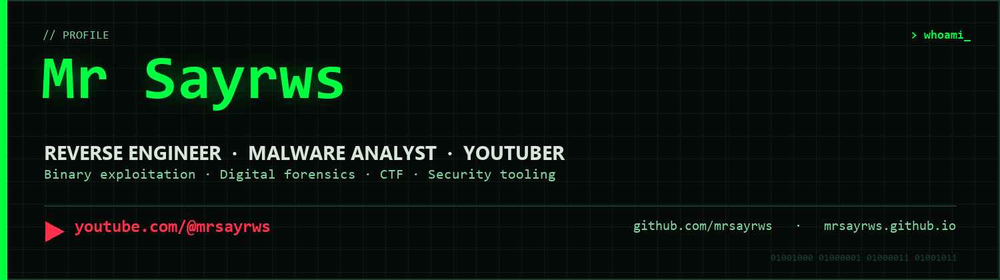

# Mr Sayrws

Reverse engineer and malware analyst. I take binaries apart — unpacking
malware, tracing C2 traffic, building exploits for CTF challenges — and
document what I find on [YouTube](https://www.youtube.com/@mrsayrws) and in my
[writing](https://mrsayrws.github.io/blog/).

- **Focus** — malware analysis, binary exploitation, digital forensics
- **Toolkit** — Ghidra, IDA Pro, x64dbg, Wireshark, Volatility
- **Also** — C/C++, C#/.NET, Python, PowerShell, Bash

## Projects

| Project | What it does |
|---|---|
| [GOLEM-LINK](https://github.com/mrsayrws/GOLEM-LINK) | LAN-only cluster for two machines: telemetry, task offload, clipboard relay, self-update. |
| [StopStealer](https://github.com/mrsayrws/StopStealer) | Real-time Windows blocker for token grabbers and infostealers. |
| [GOLEM-TABLET](https://github.com/mrsayrws/GOLEM-TABLET) | Android tablet diagnostics over USB/ADB/fastboot. Inspects only — never flashes. |
| [App2FA](https://github.com/mrsayrws/App2FA) | Offline WinForms TOTP authenticator with an AES-256-GCM vault. |
| [Ad-Blocker](https://github.com/mrsayrws/Ad-Blocker) | No-root Android DNS ad and tracker blocker. |
| [BlackNights_Release](https://github.com/mrsayrws/BlackNights_Release) | *Black Nights* — a small platformer built from scratch in Godot. |

## Writing

- [How Discord token grabbers work — and how to stop them](https://mrsayrws.github.io/blog/discord-token-grabbers.html)
- [ADB and fastboot on Windows: a practical diagnostic guide](https://mrsayrws.github.io/blog/adb-fastboot-windows-guide.html)
- [DNS ad blocking on Android without root](https://mrsayrws.github.io/blog/android-dns-ad-blocking.html)
- [Building a TOTP vault in .NET](https://mrsayrws.github.io/blog/totp-vault-dotnet.html)

[All articles](https://mrsayrws.github.io/blog/) ·
[Press kit](https://mrsayrws.github.io/press.html)

## Contact

[YouTube](https://www.youtube.com/@mrsayrws) ·
[Website](https://mrsayrws.github.io/) ·
[Email](mailto:golem-hack@agentmail.to)

---

Security work here is limited to systems I own, CTFs, or engagements with
written authorization. Malware samples stay offline in disposable VMs.
Tools are for authorized testing only.
