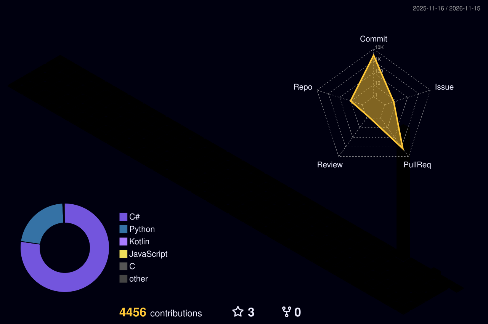

<div align="center">
<pre>█   █        ███   ███  █     █████ █   █
██ ██       █   █ █   █ █     █     ██ ██
█ █ █ █████ █     █   █ █     ████  █ █ █
█   █       █  ██ █   █ █     █     █   █
█   █        ███   ███  █████ █████ █   █</pre>
</div>

<p align="center">
  
</p>

<p align="center">
  <b>Reverse Engineer · Malware Analyst · YouTuber</b><br>
  <sub>Malware Analysis · Binary Exploitation · Digital Forensics · CTF</sub>
</p>

<p align="center">
  <a href="https://www.youtube.com/@mrsayrws">
    
  </a>
  <a href="https://hellstorm.blog">
    
  </a>
  <a href="mailto:golem-hack@agentmail.to">
    
  </a>
  <a href="https://mrsayrws.github.io/">
    
  </a>
</p>

## 🧬 B I O

> I'm **Mr Sayrws** — a Reverse Engineer and Cybersecurity Researcher obsessed with how things work under the hood... and how they break. I live inside debuggers and disassemblers: unpacking malware, tracing C2 infrastructure, crafting ROP chains, and turning crashes into working exploits.
>
> My battlefield spans **binary exploitation, malware analysis, digital forensics, and web security** — from buffer overflows and heap feng shui to memory forensics and threat intelligence. I document everything and share it through my blog **HELLSTORM**, CTF writeups, open research, and on **YouTube** — [@mrsayrws](https://www.youtube.com/@mrsayrws) is where I break down reverse engineering, malware analysis and CTF work on video.
>
> When I'm not breaking binaries, I'm building tools to analyze them: CLI utilities, automation scripts, and home labs. I believe the best way to defend a system is to understand exactly how an attacker would tear it apart.
>
> *"Understand the machine, then break it — ethically."* 💀

```diff
+ [BOOT] neural-link ................ ONLINE
+ [AUTH] clearance level 5 .......... GRANTED
+ [LOAD] malware_lab ................ READY
+ [LOAD] exploit_dev ................ READY
+ [LOAD] ctf_arena .................. READY
- [TRACE] hunter-tracer ............. BLOCKED
- [SLEEP] ........................... DISABLED
```

<p align="center"><sub>01001000 01000001 01000011 01001011 01000101 01010010</sub></p>

---

## ▶️ YouTube — Mr Sayrws

I make videos about reverse engineering, malware analysis, binary exploitation
and CTF. If you found this profile from a video, welcome — the tools and
writeups live in the repositories below.

<p align="center">
  <a href="https://www.youtube.com/@mrsayrws">
    
  </a>
</p>

- Malware analysis walkthroughs — unpacking, anti-analysis, C2 tracing
- Reverse engineering sessions in Ghidra / IDA / x64dbg
- Exploit development: stack overflows, ROP chains, heap internals
- CTF pwn / rev / forensics solutions and tooling

> **mrsayrws** is the GitHub account and YouTube channel of **Mr Sayrws** — the
> reverse engineer writing about binaries, malware and defensive tooling.

---

## ✍️ Writing — mrsayrws.github.io

Long-form notes that go with the videos: the mechanism, where it breaks, and
what actually helps.

- [How Discord token grabbers work — and how to stop them](https://mrsayrws.github.io/blog/discord-token-grabbers.html)
- [ADB and fastboot on Windows: a practical diagnostic guide](https://mrsayrws.github.io/blog/adb-fastboot-windows-guide.html)
- [DNS ad blocking on Android without root](https://mrsayrws.github.io/blog/android-dns-ad-blocking.html)
- [Building a TOTP vault in .NET: AES-GCM, PBKDF2 and the limits](https://mrsayrws.github.io/blog/totp-vault-dotnet.html)

[All articles](https://mrsayrws.github.io/blog/) ·
[Press kit & bio](https://mrsayrws.github.io/press.html) ·
[RSS](https://mrsayrws.github.io/feed.xml)

---

## 👁️ About Me

```yaml
Name:       Mr Sayrws
Role:       Reverse Engineer | Malware Analyst | YouTuber | CTF Player
Focus:      Binary Analysis · Exploit Development · Threat Intelligence
YouTube:    https://www.youtube.com/@mrsayrws
Mindset:    "Understand the machine, then break it — ethically."
Website:    https://mrsayrws.github.io/
Status:     Always learning low-level internals
```

- 🔍 **OSINT & Recon** — Threat Intelligence, Footprinting, Attribution
- 🧬 **Digital Forensics** — Memory Analysis, Disk Forensics, Artifact Recovery
- 🦠 **Malware Analysis** — Static/Dynamic Analysis, Unpacking, C2 Tracking
- 💥 **Binary Exploitation** — Buffer Overflows, ROP Chains, Heap Exploitation
- ⚙️ **Reverse Engineering** — PE Files, .NET, Unpacking, Anti-Debug Bypass
- 🕸️ **Web Security** — SQLi, XSS, SSTI, SSRF, Logic Flaws

---

## 📌 Featured repositories

| Repository | What it is |
|---|---|
| [GOLEM-TABLET](https://github.com/mrsayrws/GOLEM-TABLET) | Windows diagnostic toolkit for Android tablets: USB/ADB/fastboot/AT inspection, firmware-package validation, driver checks. Never flashes. |
| [StopStealer](https://github.com/mrsayrws/StopStealer) | Real-time Windows blocker for token grabbers and infostealers: memory signatures, process guard, browser/Discord profile monitoring. |
| [Ad-Blocker](https://github.com/mrsayrws/Ad-Blocker) | No-root Android DNS ad/tracker blocker built on a local `VpnService`, with three blocklist levels and live stats. |
| [App2FA](https://github.com/mrsayrws/App2FA) | Offline WinForms TOTP authenticator with an AES-256-GCM vault and QR import. |
| [BlackNights_Release](https://github.com/mrsayrws/BlackNights_Release) | *Black Nights* — a seven-chapter cinematic platformer made from scratch in Godot 4.7, code-drawn art and synthesized audio. |
| [esp32-wifi-audit](https://github.com/mrsayrws/esp32-wifi-audit) | ESP-IDF firmware for 802.11 auditing on ESP32: scanning, frame analysis, pcap/hccapx capture export. Authorized testing only. |
| [chess-ai-master](https://github.com/mrsayrws/chess-ai-master) | Browser extension that runs Stockfish locally for move analysis on Chess.com. Analysis and unrated play only. |
| [Spicetify-Fix-UserMode](https://github.com/mrsayrws/Spicetify-Fix-UserMode) | Tiny launcher that runs the official Spicetify installer in a non-elevated context on locked-down Windows images. |
| [Resolves-a-guild-s-owner-via-a-self-token](https://github.com/mrsayrws/Resolves-a-guild-s-owner-via-a-self-token) | Two small Discord API utilities (guild-owner lookup, webhook tester) for your own guild, API v10. |

Research and defense repositories — read their warnings before use:

| Repository | Purpose |
|---|---|
| [token-grabber-discorrd](https://github.com/mrsayrws/token-grabber-discorrd) | Sanitized malware sample preserved for defensive analysis. Never run outside an isolated VM. |
| [osint-harvester](https://github.com/mrsayrws/osint-harvester) | Archived scraping prototype kept as a cautionary record. Not maintained, not for use. |

---

## 📊 3D Contributions

<p align="center">
  
</p>

---

## 💻 Tech Stack

<p align="center">
  
</p>

<p align="center">
  
  
  
  
  
  
</p>

| Languages | RE / Analysis | Security Tools |
| --- | --- | --- |
| C / C++ | Ghidra · IDA Pro | Wireshark · Burp Suite |
| C# / .NET | x64dbg · WinDbg | Metasploit · Nmap |
| Python | dnSpy · ILSpy | Volatility · Autopsy |
| Assembly (x86/x64) | PE-bear · CFF Explorer | Hashcat · John |
| PowerShell / Bash | de4dot · UPX | Docker · Git |

---

## 📊 GitHub Stats

<p align="center">
  
  
</p>

<p align="center">
  
</p>

---

## 📈 Contribution Activity

<p align="center">
  
</p>

---

## 🚀 Featured Work

<table>
  <tr>
    <td width="50%" valign="top">
      <h3>🔬 Analysis Tooling</h3>
      <sub>Custom CLI utilities for PE inspection, .NET decompilation, unpacking and static binary analysis — built in Python & C#.</sub><br>
      <sub><code>Python</code> · <code>C#</code> · <code>PE</code></sub>
    </td>
    <td width="50%" valign="top">
      <h3>🦠 Malware Research</h3>
      <sub>Hands-on labs covering packers (Themida, VMProtect, UPX), anti-debug tricks, C2 traffic analysis and evasion techniques.</sub><br>
      <sub><code>RE</code> · <code>Forensics</code></sub>
    </td>
  </tr>
  <tr>
    <td width="50%" valign="top">
      <h3>💥 Exploit Development</h3>
      <sub>Stack overflows, ROP chain construction and heap feng shui — solving CTF pwn challenges and documenting techniques.</sub><br>
      <sub><code>Assembly</code> · <code>Python</code></sub>
    </td>
    <td width="50%" valign="top">
      <h3>🌐 Web Exploitation</h3>
      <sub>Deep dives into SQLi, SSTI, SSRF, deserialization and authentication bypass — with writeups and payload crafting.</sub><br>
      <sub><code>Burp</code> · <code>Python</code></sub>
    </td>
  </tr>
</table>

---

## 🎯 Focus Areas

- **Reverse Engineering** — Decompilation, unpacking, anti-analysis bypass
- **Malware Analysis** — Static/Dynamic, C2 tracking, IoC extraction
- **Exploit Development** — Memory corruption, ROP, shellcode
- **Digital Forensics** — Memory dumps, disk artifacts, timeline analysis
- **Threat Intelligence** — OSINT, attribution, TTP mapping
- **Security Tooling** — Automation, custom scripts, CLI utilities

---

## 🧭 Research ethics

- Security work here is limited to systems I own, CTFs, or engagements with
  written authorization.
- Malware samples are handled offline in disposable VMs; nothing in those
  repositories is meant to be executed on a real machine.
- Wireless and network tools are for authorized audits only — deauth/DoS
  testing disrupts third-party traffic and is illegal without permission.
- No tool here is built to bypass another service's anti-abuse controls;
  research uses public data and official APIs.
- Findings are documented and shared so defenders can reproduce them, not so
  they can be weaponized. Report vulnerabilities privately before publishing.

---

## 🏆 CTF & Community

<p align="center">
  <a href="https://flagyard.com/profile/70b0ad55-56d9-4d26-86f5-64182a740d2b">
    
  </a>
  <a href="https://www.youtube.com/@mrsayrws">
    
  </a>
</p>

---

```diff
@@ 4CC355 6R4N73D // 3XPL017 60N7R0L @@
```

## 👤 Terminal

```text
> whoami
Mr Sayrws — Reverse Engineer & Malware Analyst

> cat interests.txt
[*] Binary Analysis & Exploit Dev
[*] Malware Research & Unpacking
[*] CTF Player (Pwn / Rev / Forensics)
[*] Building security tooling
[*] Always learning low-level internals

> cat hobbies.txt
[*] Chess
[*] Reading Research Papers
[*] Building Cool Projects
[*] Solving CTF Challenges
```

<br clear="all">

---

<div align="center">

<pre>
      _______
   .-"       "-.
  /             \
  |             |
  |,  .-.  .-.  ,|
  | )(__/  \__)( |
  |/     /\     \|
  (_     ^^     _)
   \__|IIIIII|__/
    | \IIIIII/ |
    \         /
     `-------`
</pre>

**[!] WARNING: you are entering SAYRWS' territory [!]**

### 💬 Favorite Quote

> *"Reverse Engineering isn't just breaking things — it's understanding how they work."*

<br>

**⭐ If you find my work useful, consider starring the repos ⭐**

</div>

<p align="center">
  
</p>


